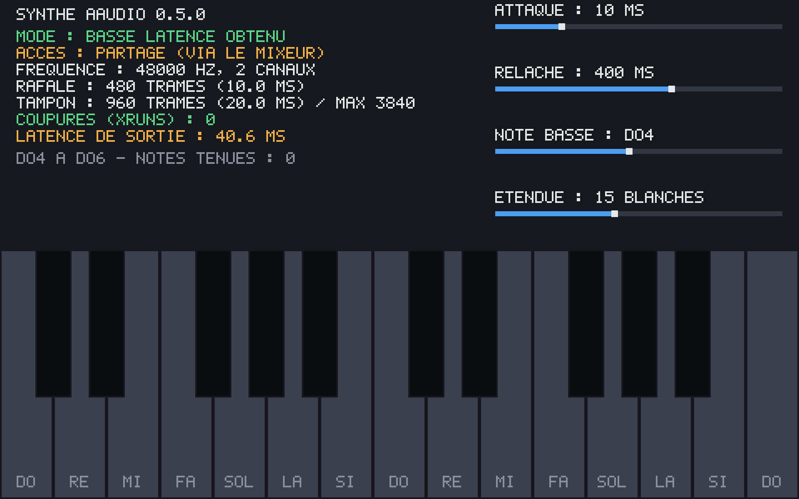

# Simpletones

Petit synthétiseur pour Android, écrit en Rust sans aucune dépendance. L'APK
fait moins de 200 Ko.

## Télécharger

**[Télécharger l'APK (version 0.5)](https://github.com/s1pierro/simpletones/releases/download/v0.5/synthe-aaudio-0.5.apk)**

Pour les appareils ARM 64 bits, sous Android 8.0 ou plus récent. L'APK étant
signé avec une clé de debug, Android demandera d'autoriser l'installation depuis
une source inconnue.

## Fonctions

- Clavier tactile réglable : note la plus basse (à partir de Do1) et étendue
  (de 5 à 29 touches blanches, jusqu'à Do8), de Do4 à Do6 par défaut
- Curseurs d'attaque et de relâche
- Son via AAudio, chargé à l'exécution avec `dlopen`
- Interface dessinée en logiciel dans une `NativeActivity`

## Construire l'APK

Le build se fait directement sur Android, dans [Termux](https://termux.dev),
avec le Rust natif de Termux : pas de SDK ni de NDK, pas de cross-compilation.

    pkg install rust aapt apksigner zip unzip curl openjdk-17
    ./build.sh

L'APK est produit dans `dist/audiotest.apk`. `./build.sh install` le construit
puis ouvre l'installeur Android.

Au premier lancement, `build.sh` télécharge `android.jar` depuis le dépôt du SDK
Android (environ 50 Mo) et crée une clé de debug dans `~/.android/`.
